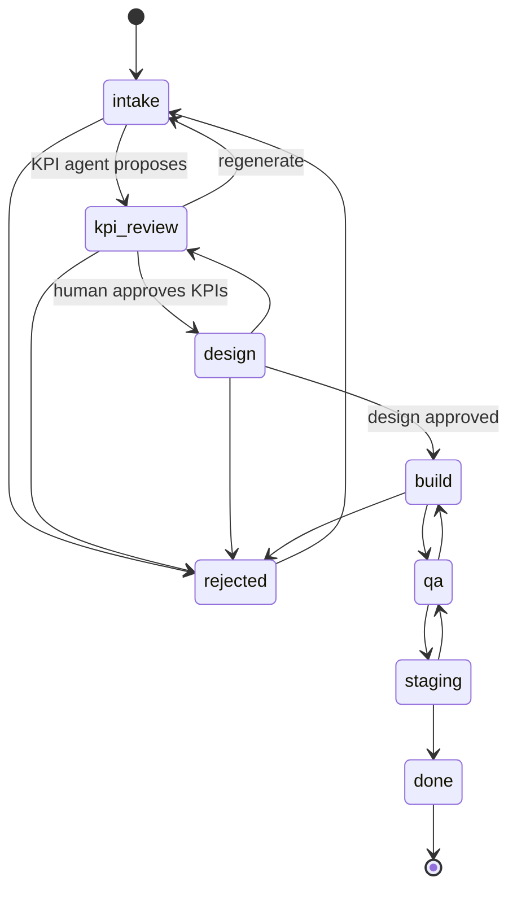
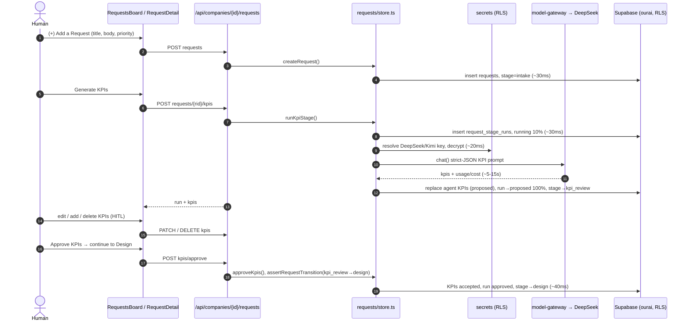
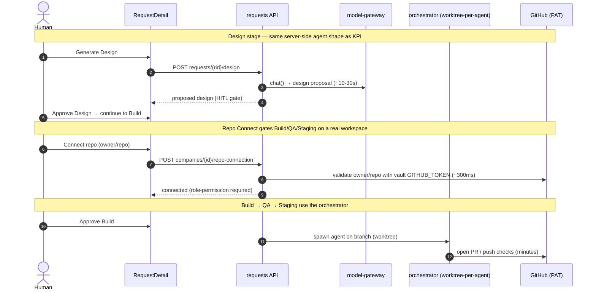
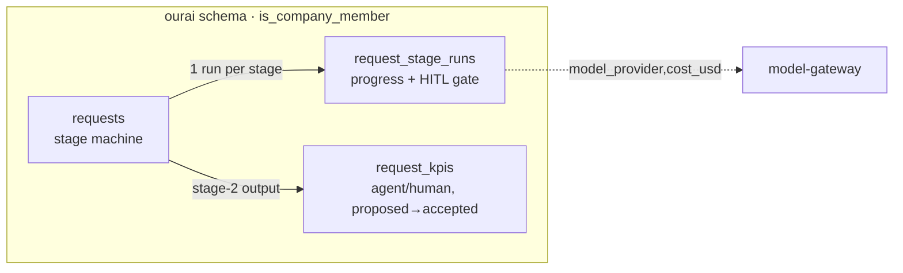

# Architecture

OurAI is five parts. Only the orchestrator is stateful and long-running;
everything else is a static/edge web app or managed infrastructure.

```
        ┌────────────┐   writes events    ┌─────────────────────┐
        │ orchestrator│ ─────────────────►│  sync fabric        │
        │  + agents   │   (append-only)    │  (Supabase:         │
        │  + tools    │                    │   events table +    │
        │  + model    │ ◄───────────────── │   Realtime)         │
        └────────────┘   reads injected    └─────────┬───────────┘
                         human messages               │ push / poll
                         ┌─────────────┬───────────────┼───────────────┐
                         ▼             ▼               ▼               ▼
                     Product        Dev             QA            Sales/PM…
                   (browser tab) (browser tab)  (browser tab)   (browser tabs)
```

## The core loop (why fan-out is free)

The orchestrator never talks to browsers directly. It appends to an ordered
`events` log. Supabase Realtime broadcasts each insert to every connected
client; a late-joiner queries the log for history, then subscribes.
**Late-joiner backfill is free because the transcript is just rows.**

## Components

| # | Component        | Package / app             | Responsibility |
|---|------------------|---------------------------|----------------|
| 1 | Web client       | `apps/web`                | Transcript UI, presence, idea board, branch view, diff + merge |
| 2 | Sync fabric      | `@ourai/persistence`      | `events` log + Realtime fan-out; pluggable behind `PersistenceAdapter` |
| 3 | Orchestrator     | `apps/orchestrator`       | Capped agent pool, worktree-per-agent, queue, budget guard |
| 4 | Model gateway    | `@ourai/model-gateway`    | Swappable `ModelProvider` (DeepSeek default), streaming, budget hooks |
| 5 | Tools            | `@ourai/tools`            | fs / git / shell / github tools bound to a worktree |
|   | Agent loop       | `@ourai/agent-core`       | plan → act → observe; tool registry (persistence-agnostic) |
|   | Shared           | `@ourai/shared`           | Event schema, state machines, branded ids, types |

## Data model

`Company (= 1 GitHub repo) → Idea backlog → Work item (= 1 branch + 1 agent) →
Session (= 1 run) → Events (append-only transcript)`.

DDL lives in [`infra/supabase/migrations`](../infra/supabase/migrations). The
`events` table carries a per-session monotonic `seq` assigned in-DB — the live
cursor for `getEvents(sinceSeq)` and realtime replay.

## Streaming vs. polling

Default push via Supabase Realtime; polling fallback (`events?since=cursor`)
behind one interface (`SYNC_MODE`). Live tokens go over ephemeral Realtime
Broadcast (not persisted); only committed events become durable rows.

## Isolation & concurrency

One agent = one branch = one git worktree from a single clone. Concurrency is
capped (`MAX_CONCURRENT_AGENTS`, default 3); submissions beyond the cap queue.
Cost tracks *running* agents, not branch count. A `BudgetGuard`
(`MONTHLY_BUDGET_USD`) pauses new spawns at the ceiling.

## Pluggability

`PersistenceAdapter` and `ModelProvider` are interfaces; Supabase + DeepSeek
ship first. Swapping either is a config change (`PERSISTENCE_PROVIDER`,
`MODEL_PROVIDER`), not a rewrite.

## Product workflow (Request → KPI → Design → Dev/QA/Staging)

The idea backlog answers *"what could we build?"* The **product workflow** is the
heavier, first-class pipeline that answers *"take this request all the way to
shipped"*. A `Request` is a new **company-scoped spine** (it does not replace the
lightweight `ideas` board). Each request advances through a **stage state
machine**; agentic stages (KPI now, Design next) run **server-side in the web
app** — a Next.js route calls the model gateway with a key from the BYOK vault —
and each writes a `request_stage_runs` row (progress meter + the
human-in-the-loop gate), mirroring the `context_jobs` pattern. No orchestrator or
worktree is involved for KPI/Design.

Tables (migration `0009_product_workflow.sql`, schema `ourai`):
`requests` → `request_stage_runs` (one per agentic run) → `request_kpis`
(stage-2 output). All are RLS-scoped by `ourai.is_company_member(company_id)`.

### Request stage machine



All stages are now **clickable agentic + human-reviewed steps**: KPI proposes
KPIs; Design a design brief; Build an implementation plan; QA a test plan;
Staging a release checklist. Each runs server-side via the model gateway, writes a
`request_stage_runs` row + stage output (`request_kpis` for KPI,
`request_stage_artifacts` for the rest), and advances on human approval —
`intake → … → done`.

The **Build stage also writes real code**: it generates file changes from the
approved plan and opens a **draft Pull Request** on the company's connected repo
via the GitHub Git Data API using a vault `GITHUB_TOKEN` (server-side, PAT-based —
`lib/github/repo.ts`). The PR link is stored on the request (`pr_url`) and shown
through to Done. It never touches the default branch. **Running** the repo's tests
and iterating until green (worktree-per-agent orchestrator, real deploys) remains
the next infra layer (ADR 0002). Feature exposure is controlled by the
`product-workflow` flag, which an admin can toggle in-app at **`/admin`** (a DB
override consulted by `isFlagEnabled` ahead of PostHog).

### Stage 1–2 sequence: Add a Request → KPI Assignment (built)



The model call (~5–15s) is the only slow step; every DB write is single-digit-to-
tens of ms. The stage-run's `progress`/`status` is the meter the UI polls, and
`status='proposed'` is the gate: nothing advances until a human approves.

### Stages 3–4 + Repo Connect (designed, not yet built)



Repo Connect/Disconnect is **PAT-based** and gated by a new company/org
**"can connect/disconnect repo" role permission**; the connected repo *is* the
company's build workspace. Build/QA/Staging reuse the existing worktree-per-agent
orchestrator (ADR 0002).

### Data flow



## Pluggability

`PersistenceAdapter` and `ModelProvider` are interfaces; Supabase + DeepSeek
ship first. Swapping either is a config change (`PERSISTENCE_PROVIDER`,
`MODEL_PROVIDER`), not a rewrite.

See the [ADRs](./adr) for the decisions behind this design and the original
[plan](./PLAN_Multiplayer_AI_v2.md).
